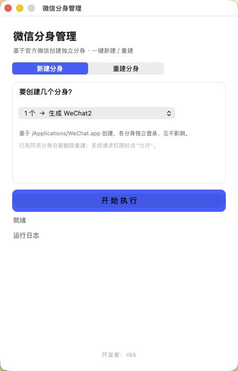

<div align="center">


# 微信分身管理 · WeChatDual

<p>一个 macOS 小工具：<b>一键创建 / 重建微信多开分身</b><br>
每个分身独立登录、互不影响，并自带「防微信更新覆盖」保护 🛡️</p>


-green)


<br>

<a href="https://github.com/chinachenkeke-source/mac-wechat-dual/releases/latest">
  
</a>

</div>

---

## ✨ 功能特性

- 🚀 **一键新建分身**：基于官方微信一键复制出最多 4 个独立分身（WeChat2 ~ WeChat5）
- 🔁 **一键重建**：微信更新后，一键把旧分身重建为最新版，保留登录状态
- 🧹 **缓存可选**：重建时可选择「保留缓存」（保留登录与聊天记录）或「清理缓存」（全新开始）
- 🛡️ **防覆盖保护**：自动关闭分身的自动更新，并给分身加系统级冻结（`uchg`），**再也不会出现「两个微信变成同一个」**
- 🎨 **原生界面**：纯 Swift/AppKit 写的 macOS 原生窗口，清爽不臃肿
- 📦 **通用二进制**：同时支持 Apple 芯片（M 系列）与 Intel Mac

---

## 📸 界面预览



---

## 🚀 安装方式

### 方式一：下载 Release（推荐，开箱即用）

1. 打开本仓库的 [**Releases**](../../releases)，下载最新的 `微信分身管理.zip`
2. 解压后，把 **微信分身管理.app** 拖进「应用程序」文件夹
3. 首次打开若提示「无法打开，因为来自身份不明的开发者」：
   - 右键点击 App → 选择「**打开**」→ 在弹窗里再点「打开」即可
   - 或到「系统设置 → 隐私与安全性」，点「仍要打开」

### 方式二：从源码编译

需要本机装有 Xcode 命令行工具（`xcode-select --install`）。

```bash
git clone https://github.com/chinachenkeke-source/mac-wechat-dual.git
cd mac-wechat-dual
chmod +x build.sh
./build.sh
# 产物在 build/微信分身管理.app，直接拖到「应用程序」即可
```

---

## 🖱️ 使用说明

> 前提：已在 Mac 上安装并登录过官方微信（`/Applications/WeChat.app`）。

### 1️⃣ 新建分身（第一次用）

1. 打开「微信分身管理」
2. 默认在「**新建分身**」页，下拉选择要开几个分身（1 个 = 生成 WeChat2，最多 4 个 = WeChat2~5）
3. 点蓝色「**开始执行**」，等约 20~30 秒
4. 提示「全部完成 ✅」后，到「访达 → 应用程序」里双击 **WeChat2**，扫码登录第二个号即可

### 2️⃣ 重建分身（微信升级后）

官方微信更新后，旧分身不会自动跟着更新。需要手动重建一次：

1. 打开「微信分身管理」
2. 切到「**重建分身**」
3. 勾选要重建的分身（如 WeChat2）
4. 「缓存处理」建议选 **保留缓存**（保留登录状态和聊天记录）
5. 点「开始执行」，完成后重新打开分身即可

### 3️⃣ 日常更新策略建议

| 程序 | 更新方式 |
|---|---|
| 官方微信（WeChat） | 保持自动更新，随便更 |
| 分身（WeChat2~5） | **不自动更新**；想更新时用本工具的「重建」一键升级 |

这样官方微信随便更，分身也永远不会被覆盖成同一个。

---

## ⚠️ 注意事项

- 本工具**不包含微信本体**，分身是运行时从你本机已安装的官方微信复制生成的
- 仅用于在个人 Mac 上同时登录多个工作 / 生活微信号，**请勿用于违规或商业用途**
- 「微信」商标与版权归腾讯公司所有，本项目与腾讯无关
- 分身已加冻结保护（`uchg`），如需手动删除某个分身，先在「重建」里处理，或在终端执行：`chflags -R nouchg /Applications/WeChatN.app && rm -rf /Applications/WeChatN.app`
- 在公司设备上使用请遵守公司信息安全规定

---

## 🗺️ 更新日志

### v1.0.0 · 2026-11-05
- 🎉 首次发布
- ✅ 支持一键新建最多 4 个微信分身
- ✅ 支持一键重建分身（保留 / 清理缓存两种模式）
- ✅ 自动关闭分身的自动更新，防止被官方更新覆盖
- ✅ 内置 `uchg` 系统级冻结保护，解决「开机后分身变原版微信」的问题
- ✅ 通用二进制（Apple 芯片 + Intel）

---

## 📄 开源协议

本项目基于 [MIT License](LICENSE) 开源，可自由使用、修改、分发，但请保留原作者署名。

## 👤 作者

**陈可可**（chenkeke）· GitHub: [@chinachenkeke-source](https://github.com/chinachenkeke-source)

如果这个工具帮到了你，欢迎点个 ⭐️ Star 支持一下～
